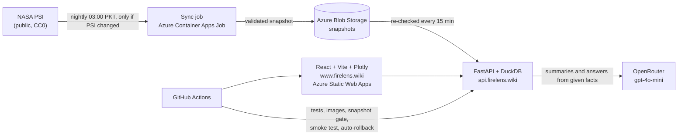

# FireLens

**Evidence-linked exploration of NASA microgravity combustion research, for fire safety in
crewed habitats.** NASA Space Apps Challenge 2026, challenge
[Flame in Freefall](https://www.spaceappschallenge.org/2026/challenges/flame-in-freefall/).

| | |
| --- | --- |
| **Live site** | https://www.firelens.wiki |
| Backup link (same site, Azure default address) | https://kind-smoke-0b5fbe80f.6.azurestaticapps.net |
| API and its interactive docs | https://api.firelens.wiki/meta · https://api.firelens.wiki/docs |
| References and AI disclosure | [REFERENCES.md](REFERENCES.md) · [docs/AI_USAGE.md](docs/AI_USAGE.md) |

## What it does

NASA's Physical Sciences Informatics (PSI) system holds two decades of combustion
experiments flown on the ISS and on uncrewed spacecraft, spread across hundreds of tables,
reports and data files. FireLens turns that collection into one workspace for a fire-safety
question: *which experiments tell us most about how fire behaves in the cabin we are
designing?*

- **Explorer.** Pick a mission profile (Earth sea level, ISS cabin, Moon base,
  pressurized rover, spacesuit) or set oxygen, pressure and airflow yourself. Investigations are ranked by how closely their measured
  test conditions match, and a coverage map shows which conditions have been tested and
  where the gaps are.
- **Investigation.** Each investigation's purpose, hardware, test records, findings and
  publications, with its PSI accession, version and DOI.
- **Compare.** Two or more investigations side by side: what is the same, what differs.
- **Ask FireLens.** Questions in plain language, answered only from retrieved report
  excerpts and measurement rows. Every claim is cited (accession, DOI, file, page or row);
  charts in answers are drawn from the cited rows. If nothing relevant is found, it says so.
- **Export.** The records behind any view as CSV or JSON, with their sources.

**Data in the live snapshot:** 24 PSI Combustion Science investigations (all with DOIs),
2,009 source records from 22 experimental tables (1,879 individual measurements usable
for ranking) and 2,632 text passages from reports and NASA context pages. Four
investigations have no machine-readable tables and are shown with their metadata and
links only.

<!-- Screenshots: add 2–3 images of Explorer, an Investigation and an Ask answer here. -->

## How it stays trustworthy

1. **Numbers come from code, words from the model.** Rankings, ranges, counts and chart
   data are computed with SQL over the snapshot. The language model (`openai/gpt-4o-mini`
   through OpenRouter) only writes summaries and explanations from facts it is handed.
2. **Every claim cites a source**, and a missing value stays empty. Nothing is invented
   to fill a gap; an empty oxygen or pressure cell stays empty.
3. **No calls to NASA while you browse.** A sync job harvests PSI into a validated
   snapshot; the API serves that snapshot. Raw Data folders (up to ~2 TB) are linked, never
   downloaded.

## Architecture



- **Harvest** (`harvest/`): paginates the PSI catalogue, keeps Combustion Science, saves
  each manifest, experimental CSV and report under 20 MB, plus eight NASA context pages.
  Column maps (`harvest/maps/PSI-<n>.yaml`) convert units: `o2_fraction` 0–1,
  `pressure_kpa`, `flow_cm_s`, sizes in mm.
- **Snapshot** (`snapshots/<id>/`): `tests.parquet`, `investigations.json`,
  `chunks.jsonl`, `vectors/` and `SNAPSHOT.md`. Each snapshot format has an id, and the
  API only reads snapshots in its own format, so a code change can never make it read
  data it would reject.
- **Deploys** (`.github/workflows/deploy.yml`) run only after tests pass and a valid
  snapshot exists. The new API is smoke-tested and rolled back automatically if it fails.
  See [infra/README.md](infra/README.md).

## Run it locally

Needs Git, [uv](https://docs.astral.sh/uv/) (installs Python 3.12), Node.js 22.13+ and npm.
No cloud account or API key is required.

```bash
uv sync --frozen
cd web && npm ci && cd ..
make api     # http://127.0.0.1:8000/docs
make web     # http://127.0.0.1:5173 (offline fixtures by default)
```

Without Make: `uv run uvicorn api.main:app --reload` and `cd web && npm run dev`.
To use real data: `uv run python -m harvest.run` (about 4 minutes, ~130 MB), then
`uv run python -m harvest.pipeline all`, set `FIRELENS_MODE=snapshot` in `.env`, and in
`web/.env.local` set `VITE_DATA_MODE=api`. Set `LLM_PROVIDER=offline` to run without
model calls.

Checks: `make lint`, `make test`, `make contracts`. CI also runs the web lint, tests and
production build.

## Repository layout

| Folder | Contents |
| --- | --- |
| `harvest/` | PSI collection, column maps, normalization, snapshot building |
| `api/` | FastAPI, DuckDB ranking and filtering, cited chat (RAG), exports |
| `web/` | React, TypeScript, Tailwind and Plotly dashboard |
| `sync/` | Nightly sync job: detect PSI changes, rebuild, validate, publish |
| `scripts/` | Snapshot checker, contract export, fixture refresh |
| `config/` | Mission profiles and ranking weights (illustrative assumptions) |
| `infra/` | Azure provisioning script and runbook |
| `docs/` | Plan, decisions, contracts, phase notes |

## Scientific boundaries

Mission profiles and ranking weights are design assumptions, not NASA mission
specifications, material certifications or fire-risk predictions. Only investigations
with individual measurements under comparable conditions are scored; others are shown
unscored. A gap on the coverage map means no matching evidence *in this collection*, not
that no research exists. PSI contains no partial-gravity combustion data, and FireLens
does not invent any. Rockets and propellants are out of scope.

## Credits

Data: NASA Physical Sciences Informatics (CC0); every investigation is listed with its DOI
in [REFERENCES.md](REFERENCES.md). FireLens is an independent project, not endorsed by
NASA. Code is MIT licensed ([LICENSE](LICENSE)). Built by Talha Adil, Muhammad Qambar
Hussain and AsadUllah Nizami.
